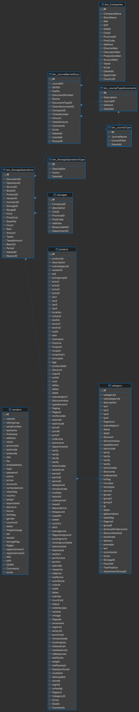
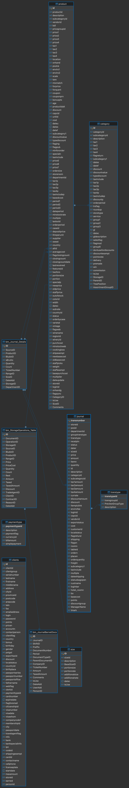
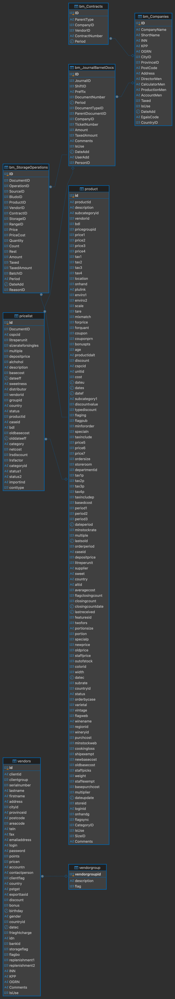
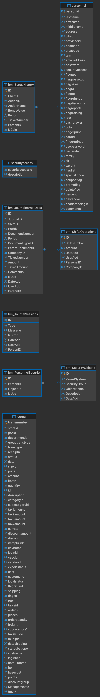
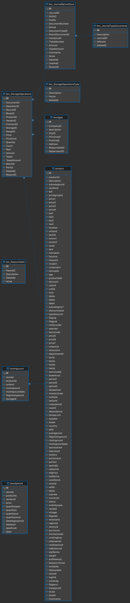

# Анализ ресурсов базы данных Front

база `Front` содержит 243 таблицы, описания структуры нет, поэтому состав направлений я определял по внешним ключам, справочникам и самим данным, выводы проверял запросами из файла `queries_analysis.sql`

условные обозначения
- **FK** - связь сделана внешним ключом
- **без FK** - связь есть по смыслу, но внешнего ключа нет, проверил запросом

колонки, которые не нужны для анализа (настройки кассы, налоги, служебные поля), я не описывал

## Общие таблицы

эти таблицы нужны сразу в нескольких направлениях

### bm_JournalBarnetDocs - журнал документов
шапка любого документа (приход, списание, товарный чек и т. д.), вид документа определяет `DocumentTypeID`, строк: 55 149

| Колонка | Назначение | Пример |
|---|---|---|
| ID | код документа | 465989 |
| JournalID | вид журнала, FK на `bm_JournalType` | 2 |
| ShiftID | смена, FK на `bm_ShiftsOperations` | 65 |
| DocumentNumber | номер документа | 173005 |
| Period | дата и время документа | 2023-12-04 20:13:13 |
| DocumentTypeID | тип документа, FK на `bm_JournalTypeDocuments` (4 поступление, 5 списание, 6 товарный чек, 8 инвентаризация) | 6 |
| CompanyID | организация, FK на `bm_Companies` | 6 |
| TicketNumber | номер чека кассы | 14740696 |
| Amount | сумма документа | 688.50 |
| PersonID | сотрудник (без FK на `personnel`) | 906 |

### bm_JournalTypeDocuments - виды документов
| Колонка | Назначение | Пример |
|---|---|---|
| ID | код вида документа | 4 |
| Description | название | Поступление продуктов |
| JournalID | журнал, к которому относится, FK на `bm_JournalType` | 3 |

### bm_JournalType - виды журналов
| Колонка | Назначение | Пример |
|---|---|---|
| ID | код журнала | 3 |
| JournalName | название | Складской учет |

значения - 1 хозяйственный учет, 2 финансовый учет, 3 складской учет, 4 кассовый учет, 5 производство, 7 бронирование

### bm_StorageOperations - движения склада
одна строка на товар в документе, вид операции в `OperationID`, строк: 1 031 198

| Колонка | Назначение | Пример |
|---|---|---|
| ID | код строки | 6326207 |
| DocumentID | документ, FK на `bm_JournalBarnetDocs` | 465989 |
| OperationID | вид операции, FK на `bm_StorageOperationsType` | 2 |
| ProductID | товар, FK на `product` | 7682 |
| VendorID | поставщик (без FK на `vendors`) | 0 |
| ContractID | договор (без FK на `bm_Contracts`) | 0 |
| StorageID | склад, FK на `storages` | 41 |
| Price | цена | 346.25 |
| Quantity | не используется (везде 0, запрос 5.2) | 0.0000 |
| Count | количество со знаком (приход плюс, списание минус) | -0.0200 |
| Rest | остаток после операции (не заполняется, везде 0, запрос 5.4) | 0.0000 |
| Amount | сумма со знаком (списание отрицательное) | -6.93 |
| ReasonID | причина списания (без FK на `bm_ReasonDebit`, у большинства списаний 0) | 7 |
| DateAdd | дата операции | 2023-12-04 21:55:37 |

### bm_StorageOperationsType - виды складских операций
| Колонка | Назначение         | Пример |
|---|--------------------|---|
| ID | код операции       | 1 |
| Description | название           | Поступление |
| Factor | влияние на остаток | 1 |

значения - 1 поступление (+1), 2 списание (-1), 3 инвентаризация (+1), 4 перемещение (+1), 5 возврат (+1)

### product - номенклатура
справочник товаров, блюд и ингредиентов, строк: 1 545, колонок 119 (большая часть это настройки кассы)

| Колонка | Назначение | Пример |
|---|---|---|
| id | код товара | 7719 |
| productid | внешний код | 7427483 |
| description | название | Комбо 5 30 см |
| vendorid | поставщик по умолчанию (без FK) | 0 |
| CategoryID | категория, FK на `category` | 359 |
| price1 | розничная цена (не заполнена) | - |
| cost | себестоимость (не заполнена, везде 0) | 0.00 |
| onhand | остаток в карточке товара | - |
| SizeID | единица измерения, FK на `size` | 1 |

### category - категории товаров (дерево)
| Колонка | Назначение | Пример |
|---|---|---|
| id | код категории | 147 |
| description | название | Меню доставка |
| ParentID | родительская категория | 0 |
| StorageID | склад | 41 |

### storages - склады
| Колонка | Назначение | Пример |
|---|---|---|
| id | код склада | 41 |
| CompanyID | организация (без FK) | 6 |
| description | название | Склад |
| ResponsibleID | ответственный (без FK) | 897 |

### bm_Companies - организации
| Колонка | Назначение | Пример |
|---|---|---|
| ID | код организации | 6 |
| CompanyName | полное название | ИП... |
| ShortName | краткое название | Пиzzбург |
| INN | ИНН | - |

---

## 1. Анализ закупки продукции (шаг месяц)

на диаграмме только связи с внешними ключами, а связь строк склада с поставщиком (`bm_StorageOperations.VendorID` и `vendors.id`) без ключа, ее проверил запросом 3.2

**Основные таблицы** - `bm_JournalBarnetDocs` (документы типа 4 "Поступление продуктов") и `bm_StorageOperations` (строки этих документов с `OperationID = 1`)
**Связанные** - `bm_JournalTypeDocuments`, `bm_JournalType`, `bm_StorageOperationsType`, `product`, `category`, `storages`, `bm_Companies`, `vendors` (связь по `VendorID`, без FK)

отдельной таблицы закупок нет, закупка это документ типа 4 и его складские строки с операцией 1, одной операции 1 для отбора недостаточно, такие строки есть и в товарных чеках (тип 6), но без поставщика (запросы 1.2 и 1.5), старые таблицы `receiving` (17 строк, 2002-2003 годы) и `orders` (6 строк, 2007-2009 годы) не используются

колонки `bm_JournalBarnetDocs`, `bm_StorageOperations`, `product` и остальных таблиц описаны выше

подтверждающие запросы 1.1-1.5

## 2. Анализ продажи товара (шаг месяц)

на диаграмме только внешние ключи, без ключей, но проверены запросами, связь `journal` с документами `bm_JournalBarnetDocs` (`receiptn = TicketNumber`, запрос 2.5) и справочники оплат и клиентов (запрос 2.6)

**Основные таблицы** - `journal` (чеки кассы) и `bm_Journal_Details` (состав проданных блюд)
**Связанные** - `transtype`, `product`, `category`, `size`, `paymenttype`, `clients`, `bm_JournalBarnetDocs` (документ "Товарный чек", тип 6), `bm_StorageOperations_Table`

### journal - журнал кассы
каждая строка это одно событие кассы, вид события в `transtype`, строк: 225 681, период 2020-11-11 - 2023-12-06

| Колонка | Назначение | Пример |
|---|---|---|
| transnumber | код строки | 1951181 |
| receiptn | номер чека | 50672281 |
| transtype | вид записи, FK на `transtype` (101 продажа позиции, 211 оплата наличными, 501 итог чека, 111 списание, 301 вход, 386/387 начало и конец работы) | 101 |
| dater | дата и время | 2023-12-06 13:58:26 |
| id | код товара | 7239833 |
| description | название позиции | Соус Барбекю |
| quantity | количество | 1.000 |
| price | цена | 50.00 |
| amount | сумма | 50.00 |
| loginid | кассир, код сотрудника (без FK на `personnel`) | 906 |
| customerid | клиент (без FK на `clients`) | 12345 |

### transtype - справочник видов записей журнала
| Колонка | Назначение | Пример |
|---|---|---|
| transtypeid | код вида | 101 |
| transgroupid | группа | 1 |
| description | название | PLU Sales |

### bm_Journal_Details - состав проданных блюд
для каждой проданной позиции хранит ингредиенты блюда, строк: 1 089 641, привязана в основном к проданным позициям (97 %), но также к итогам чеков и списаниям по себестоимости (запрос 2.3)

| Колонка | Назначение | Пример |
|---|---|---|
| ID | код строки | 225297748 |
| SourceID | строка журнала, FK на `journal.transnumber` | 1950990 |
| ProductID | ингредиент, FK на `product` | 7650 |
| BludoID | блюдо, FK на `product` | 4822 |
| Count | расход ингредиента на порцию | 0.0800 |
| TicketNumber | номер чека | 52169561 |
| StorageID | склад | 41 |
| DateAdd | дата | 2023-12-04 21:54:50 |

### bm_StorageOperations_Table - списания по кассовым документам
строк: 30 801 (почти все с `OperationID = 2`, одна с `OperationID = 1`)

| Колонка | Назначение | Пример |
|---|---|---|
| ID | код строки | 165000 |
| DocumentID | документ, FK на `bm_JournalBarnetDocs` | 465974 |
| ProductID | товар, FK на `product` | 4382 |
| Amount | сумма со знаком | -13.7700 |
| ClientID | клиент (без FK) | 0 |

### paymenttype - виды оплаты
| Колонка | Назначение | Пример |
|---|---|---|
| paymenttypeid | код вида оплаты | 211 |
| description | название | Наличные |

### clients - клиенты
карточки клиентов, часть из них служебные (например "Самовывоз" с бонусом 10 % и "Скидка по чековым" с бонусом 15 %)

| Колонка | Назначение | Пример |
|---|---|---|
| id | код клиента | 110 |
| clientid | номер карты или код | 1235 |
| clientgroup | группа клиентов, FK на `clientgroup` | 40 |
| lastname | фамилия клиента или название служебной карточки | Оганез |
| bonus | процент бонуса | 40.000 |

### size - единицы измерения
| Колонка | Назначение | Пример |
|---|---|---|
| ID | код | 2 |
| sizeid | обозначение | 100г |
| portionsize | единица (г, мл) | г |

подтверждающие запросы 2.1-2.6

## 3. Анализ взаимоотношений с поставщиками (шаг месяц)

на диаграмме только внешние ключи (`vendors` и `vendorgroup`, документы и склад), связь `bm_StorageOperations.VendorID` с `vendors.id` без ключа, проверена запросом 3.2, таблицы `bm_Contracts` и `pricelist.vendorid` в данных не используются (запрос 3.4)

**Основные таблицы** - `vendors` и `vendorgroup` (FK `vendors.clientgroup`)
**Связанные** - `bm_StorageOperations` (`VendorID`, без FK, берутся строки документов закупки, тип 4), `bm_JournalBarnetDocs`, `pricelist` (`vendorid`, без FK), `bm_Contracts` (договоры, пустая), `bm_Companies`, `product` (`vendorid`)

### vendors - поставщики
строк: 63

| Колонка | Назначение | Пример |
|---|---|---|
| id | код поставщика | 91 |
| clientid | название | Габур |
| clientgroup | группа, FK на `vendorgroup` | 31 |
| firstname | полное название | ИП Габур |
| INN, KPP | реквизиты | - |
| IsUse | признак "используется" | 1 |

### vendorgroup - группы поставщиков
| Колонка | Назначение | Пример |
|---|---|---|
| vendorgroupid | код группы | 31 |
| description | название | Поставщики |

### pricelist - прайс-листы
строк: 24 797

| Колонка | Назначение | Пример |
|---|---|---|
| id | код строки | 234802 |
| DocumentID | документ, FK на `bm_JournalBarnetDocs` | 465980 |
| productid | товар, FK на `product` | 4377 |
| vendorid | поставщик (без FK) | - |
| netcost | закупочная цена | 404.00 |
| basecost | базовая цена | 0.00 |

### bm_Contracts - договоры (строк: 0)
| Колонка | Назначение |
|---|---|
| ID | код договора |
| CompanyID | организация, FK на `bm_Companies` |
| VendorID | поставщик (без FK) |
| ContractNumber | номер договора |

подтверждающие запросы 3.1-3.5

## 4. Анализ работы персонала (шаг квартал, полгода)

на диаграмме только внешние ключи (`personnel` и `bm_BonusHistory`, `bm_PersonnelSecurity` и `bm_SecurityObjects`, документы и смены), без ключей, но проверены запросами, `journal.loginid` с `personnel.personid` (4.2), `bm_JournalBarnetDocs.PersonID` (4.5) и `bm_PersonnelSecurity.PersonID` (4.6), роль из `personnel.securityaccess` почти ни у кого не находится в справочнике ролей (4.1)

**Основные таблицы** - `personnel`, `bm_PersonnelSecurity`
**Связанные** - `securityaccess` (роли), `bm_SecurityObjects` (права, FK), `bm_BonusHistory` (FK на `personnel`), `journal` (`loginid`), `bm_JournalBarnetDocs` (`PersonID`), `bm_ShiftsOperations`, `bm_JournalSessions`

### personnel - сотрудники
строк: 109

| Колонка | Назначение | Пример |
|---|---|---|
| personid | код сотрудника | 897 |
| lastname, firstname, middlename | ФИО (у 897 это служебная учетная запись "Администратор Barnet") | Администратор Barnet |
| securityaccess | роль, ссылка на `securityaccess` (без FK) | 9 |
| flagpos | работает на кассе (1 у 12 сотрудников из 109) | 1 |
| bartender | бармен (у всех 0) | 0 |
| deleteflag | признак "удален / уволен" (у всех 109 стоит 1, запрос 4.1) | 1 |

### securityaccess - роли
| Колонка | Назначение | Пример |
|---|---|---|
| securityaccessid | код роли | 3 |
| description | название | Manager/Adm |

значения - 2 Clerk, 3 Manager/Adm, 4 Bartender, 9 Special Access

### bm_PersonnelSecurity - права сотрудников
строк: 1 402

| Колонка | Назначение | Пример |
|---|---|---|
| ID | код | 1397 |
| PersonID | сотрудник (без FK на `personnel`) | 906 |
| ObjectID | объект прав, FK на `bm_SecurityObjects` | 36 |
| IsUse | право включено | 1 |

### bm_SecurityObjects - обьекты прав (формы и операции)
| Колонка | Назначение | Пример |
|---|---|---|
| ID | код | 1 |
| ParentSystem | подсистема | Manager |
| SecurityGroup | группа | Прочее |
| ObjectName | техническое имя | dlgProperties |
| Description | описание | Форма настроек |

### bm_BonusHistory - начисление бонусов
строк: 44 866

| Колонка | Назначение | Пример |
|---|---|---|
| ID | код | 84859 |
| ClientID | клиент | 255 |
| BonusValue | сумма чека, с которой считается бонус (в строке с `IsCalc = 1` там накопленный итог по клиенту, например 13 542 789,74) | 884.00 |
| Period | дата | 2023-12-06 10:31:54 |
| TicketNumber | чек | 59368651 |
| PersonID | сотрудник, FK на `personnel` | 906 |

### bm_ShiftsOperations - смены
строк: 1

| Колонка | Назначение | Пример |
|---|---|---|
| ID | код смены | 65 |
| ShiftNumber | номер | 1 |
| PersonalID | сотрудник (без FK) | 0 |
| DateAdd | дата | 2015-07-14 10:29:13 |

### bm_JournalSessions - журнал работы приложения
строк: 174 072

| Колонка | Назначение | Пример |
|---|---|---|
| ID | код | 174071 |
| Type | раздел системы, откуда пришло сообщение | barnetbc.ru |
| IsError | признак ошибки | 1 |
| DateAdd | дата | 2023-12-06 14:18:08 |
| PersonID | сотрудник (без FK) | 897 |

работа сотрудника на кассе берется из `journal` (`loginid`, `transtype` 301 вход, 386 и 387 начало и конец работы, 101 продажи)

подтверждающие запросы 4.1-4.6

## 5. Анализ остатков (шаг неделя)

на диаграмме только внешние ключи, связь причин списания (`bm_StorageOperations.ReasonID` и `bm_ReasonDebit`) без ключа, проверена частично (запрос 5.6), таблицы `closingcount` и `stockperiod` показаны как таблицы, которые не используются (запрос 5.1)

**Основные таблицы** - `bm_StorageOperations` и `bm_StorageOperationsType`
**Связанные** - `bm_JournalBarnetDocs`, `bm_JournalTypeDocuments`, `product`, `storages`, `bm_ReasonDebit` (причины списания), `closingcount`, `stockperiod`

таблицы с готовыми остатками (`stock`, `onhand`, `closingcount`, `storagesonhand`) пустые, `stockperiod` содержит 56 строк за февраль 2015 года, остаток считается по движениям склада: сумма колонки `Count` по товару (она уже со знаком, приход плюс, списание минус), описание `bm_StorageOperations`, `bm_StorageOperationsType`, `product`, `storages` есть в разделе "Общие таблицы"

### bm_ReasonDebit - причины списания (дерево)
| Колонка | Назначение | Пример |
|---|---|---|
| ID | код | 1 |
| ParentID | родитель | 0 |
| Description | название | Порча продукта |

### stockperiod - старые остатки по периодам (2015)
| Колонка | Назначение | Пример |
|---|---|---|
| id | код | 56 |
| storeid | склад | 14 |
| price | цена | 2.80 |
| quantityopen / quantityclose | остаток на начало и конец периода | 0.000 |
| quantityin / quantityout | приход и расход | 25000.000 |
| datestart | начало периода | 2015-02-18 12:11:28 |

### closingcount - результаты инвентаризации (строк: 0)
| Колонка | Назначение |
|---|---|
| productid | товар, FK на `product` |
| storageid | склад |
| closingcount | фактический остаток |
| closingcountdate | дата инвентаризации |

подтверждающие запросы 5.1-5.6

## Запросы и результаты

все запросы лежат в файле `queries_analysis.sql`, ниже для каждого запроса описание, результат (скрин) и вывод

### 1. Закупки

#### Запрос 1.1

какие виды документов есть и сколько их (тип 4 "Поступление продуктов" это закупка)

**Вывод** - закупкой является тип документа 4 "Поступление продуктов", 3175 документов на 19 657 112,54, период с 26.10.2020 по 02.12.2023, остальные типы (товарный чек, списание, установка цен и т. д.) закупкой не являются

#### Запрос 1.2

строки операции 1 (поступление) встречаются в документах двух типов - 4 (закупка) и 6 (товарный чек), поэтому закупки нужно отбирать по типу документа, а не только по операции

**Вывод** - складские строки операции "Поступление" (`OperationID = 1`) встречаются в документах двух типов - 4 (11 358 строк) и 6 "Товарный чек" (10 658 строк), поэтому закупки отбираются по типу документа, а не только по операции

#### Запрос 1.3

сумма документов закупки сходится с суммой их строк на складе

**Вывод** - сумма документов типа 4 (19 657 112,54) равна сумме их складских строк (19 657 112,54), связь документа и строк по `DocumentID` работает, закупку можно считать по любой из двух таблиц

#### Запрос 1.4

закупки по месяцам (шаг анализа месяц)

**Вывод** - закупки по месяцам с октября 2020 по декабрь 2023 (39 месяцев), обычно 50-150 документов на 300-700 тыс., сильно выделяется март 2021 (3,03 млн), он в 5-6 раз больше соседних месяцев, первый и последний месяцы неполные

#### Запрос 1.5

чем отличаются строки операции 1 в закупке (тип 4) и в товарном чеке (тип 6), в закупке есть поставщик, в чеке поставщика нет

**Вывод** - в закупках (тип 4) у всех 11 358 строк указан поставщик (21 разный), в чеках (тип 6) у всех 10 658 строк поставщика нет (`VendorID = 0`), сумма 361 577,74, операция 1 в чеках не является закупкой, скорее всего это внутреннее поступление

### 2. Продажи

#### Запрос 2.1

виды записей в журнале кассы (101 продажа позиции, 211 оплата наличными, 501 итог чека)

**Вывод** - в `journal` главные записи - 101 "PLU Sales" (проданные позиции, 119 367 строк, 42,3 млн), 501 "Total" (итог чека, 45 014) и 211 "Cash" (оплата наличными, 42 756), также есть 386 и 387 (начало и конец работы), 301 (вход), 111 (списание по себестоимости) и 20 оплат картой Visa (216), период 11.11.2020 - 06.12.2023

#### Запрос 2.2

итог чека (501) = сумме проданных позиций (101) в том же чеке

**Вывод** - из 43 035 чеков, у которых есть и позиции, и итог, у 43 024 итог равен сумме позиций, у 11 различается, чек можно считать как по строкам 101, так и по итогу 501, расхождение в 11 чеках (0,03 %) скорее всего объясняется скидками или округлением

#### Запрос 2.3

состав блюд (bm_Journal_Details) привязан к проданным позициям журнала

**Вывод** - все 1 089 641 строка состава блюд (`bm_Journal_Details`) нашлись в `journal` через `SourceID = transnumber`, из них 1 061 948 (97 %) относятся к проданным позициям (101), 17 551 к списаниям по себестоимости (111) и 10 142 к итогам чеков (501)

#### Запрос 2.4

продажи по месяцам (шаг анализа месяц)

**Вывод** - продажи по месяцам с ноября 2020 по декабрь 2023 (38 месяцев), обычно 900-1700 чеков и 0,9-1,7 млн в месяц, пики - декабрь 2022 (1,72 млн) и январь 2021 (1,53 млн), спад летом, первый и последний месяцы неполные

#### Запрос 2.5

чек из журнала касс соответствует документу "Товарный чек" (тип 6)

**Вывод** - все 43 586 документов "Товарный чек" (тип 6) нашлись в журнале кассы по номеру чека (`TicketNumber = receiptn`, запись 501), связь `bm_JournalBarnetDocs` и `journal` подтверждена на 100 проц, хотя внешнего ключа нет

#### Запрос 2.6

справочники из группы продаж действительно связаны с журналом кассы (внешних ключей нет), виды оплаты (journal.transtype = paymenttype.paymenttypeid) и клиенты (journal.customerid = clients.clientid)

**Вывод** - все 42 776 оплат (наличные 211 и Visa 216) находят свой вид оплаты в `paymenttype` (не найдено 0), из 35 632 проданных позиций, где указан клиент, у 5 клиент не найден в `clients` (99,99 % совпадений), обе связи подтверждены, хотя внешних ключей нет

### 3. Поставщики

#### Запрос 3.1

поставщики по группам (внешний ключ vendors.clientgroup на vendorgroup)

**Вывод** - в `vendors` 63 поставщика в двух группах (внешний ключ `clientgroup` на `vendorgroup` работает) - "Поставщики" (59, из них 17 активны) и "Без названия" (4, из них 3 активны)

#### Запрос 3.2

в поступлениях VendorID указывает на существующего поставщика (внешнего ключа нет)

**Вывод** - все 11 358 строк закупок (документы типа 4) содержат поставщика, который найден в `vendors` (строк без поставщика 0), использовано 21 из 63 поставщиков, связь `bm_StorageOperations.VendorID = vendors.id` подтверждена, хотя внешнего ключа нет

#### Запрос 3.3

закупки по месяцам, сколько поставщиков, документов и на какую сумму (шаг анализа месяц)

**Вывод** - закупки по месяцам (ноябрь 2020 - декабрь 2023), обычно 9-16 поставщиков в месяц, 45-145 документов, 0,3-0,8 млн, сильно выделяется март 2021 (3,02 млн), декабрь 2023 неполный, суммы немного отличаются от запроса 1.4, потому что там месяц берется по дате документа, а здесь по дате складской строки

#### Запрос 3.3.1

десять крупнейших поставщиков за весь период

**Вывод** - закупки сильно сконцентрированы, "Пятая Армия" дала 9,84 млн (50 % всех закупок), десять крупнейших поставщиков вместе 18,58 млн (около 94,5 %)

#### Запрос 3.4

договоры пустые, значит связь с поставщиком идет только через складские строки и прайс-лист

**Вывод** - таблица договоров `bm_Contracts` пустая, `pricelist.vendorid` нигде не заполнен, в карточке товара поставщик указан только у одного товара, `ContractID` в строках поступления не используется, отношения с поставщиками можно анализировать только по складским строкам закупок

#### Запрос 3.5

дубли поставщиков (одно название в разных группах)

**Вывод** - в `vendors` есть дубли - "Габур" (2 записи, группы 31 и 32) и "Столярская" (2 записи в группе 31), при анализе по названию такие записи складываются, при анализе по `id` считаются разными поставщиками

### 4. Персонал

#### Запрос 4.1

сотрудники по ролям и признаку "уволен"

**Вывод** - все 109 сотрудников в `personnel` имеют `deleteflag = 1`, то есть по этому признаку активных сотрудников не отличить, у 102 сотрудников код роли не найден в справочнике `securityaccess` (роль `NULL`), у 5 роль "Special Access", у 2 "Manager/Adm"

#### Запрос 4.2

в журнале кассы loginid это код сотрудника (внешнего ключа нет)

**Вывод** - все 119 367 проданных позиций в `journal` имеют `loginid`, который нашелся в `personnel` (строк без сотрудника 0), связь `journal.loginid = personnel.personid` подтверждена, хотя внешнего ключа нет

#### Запрос 4.3

выручка по сотрудникам и кварталам (шаг анализа квартал)

**Вывод** - выручка по кварталам (4 кв. 2020 - 4 кв. 2023) вся записана на одного сотрудника, код 906 (в справочнике "Доставка"), продажи идут под общей учетной записью, поэтому сравнивать кассиров по выручке нельзя, выручка 2,3-4,2 млн в квартал, максимум в 1 кв. 2021 и 4 кв. 2022, первый и последний кварталы неполные

#### Запрос 4.4

рабочие смены: начало (386) и окончание (387) работы по сотрудникам

**Вывод** - работу отдельных сотрудников видно по записям начала и окончания работы (386 и 387), их ведут 35 сотрудников, от 1 до 707 смен, количество начал и окончаний почти совпадает, по первой и последней дате видно текучесть, часть сотрудников работает с 2020 по конец 2023, многие отработали несколько месяцев

#### Запрос 4.5

документы тоже привязаны к сотруднику (PersonID)

**Вывод** - из 55 149 документов в `bm_JournalBarnetDocs` у 55 148 `PersonID` найден в `personnel`, один документ без сотрудника, связь подтверждена почти полностью

#### Запрос 4.6

права доступа: сколько прав у каждого сотрудника (внешний ключ на bm_SecurityObjects)

**Вывод** - права доступа назначены 48 сотрудникам, у большинства по 16 прав, у администратора (897) 24, у остальных от 1 до 22, связь `bm_PersonnelSecurity` с `bm_SecurityObjects` (внешний ключ) и с `personnel` (без ключа) работает

### 5. Остатки

#### Запрос 5.1

готовые таблицы остатков пустые или устарели

**Вывод** - таблицы с готовыми остатками `stock`, `onhand`, `closingcount` и `storagesonhand` пустые, `stockperiod` содержит 56 строк, последняя запись от 18.02.2015, остатки придется считать по движениям склада

#### Запрос 5.2

движения склада по видам операций, количество лежит в колонке Count (уже со знаком), Quantity не используется

**Вывод** - в `bm_StorageOperations` два вида операций - "Поступление" (22 016 строк, количество 130 625,83, сумма 20,0 млн) и "Списание" (1 009 182 строки, количество −728 963,85, сумма −86,1 млн), колонка `Quantity` везде нулевая, реальное количество хранится в `Count` и уже со знаком (у списаний отрицательное)

#### Запрос 5.3

остаток по товарам = сумма Count (приход с плюсом, списание с минусом), 20 товааров с наиб приходом

**Вывод** - остаток товара = сумме `Count`, у многих товаров списано намного больше, чем поступило (например, мука в/с, приход 15 044, списание 78 027, остаток −62 983), то есть приходы внесены не полностью, у штучных товаров (булочка для гамбургера, яйцо перепелиное, лепешка, лосось) остаток положительный, минус по основным продуктам значит, что без инвентаризации реальный остаток по этим данным не узнать

#### Запрос 5.4

колонка Rest в строках склада (заполнена или нет)

**Вывод** - колонка `Rest` ("остаток после операции") не заполнена ни в одной из 1 031 198 строк, готового остатка в движениях нет

#### Запрос 5.5

движения склада по неделям, последние 15 недель (шаг анализа неделя)

**Вывод** - движения склада по неделям, послеедние 15 недель, приходов 34-196, списаний 4161-8194 в неделю, последняя неделя (с 04.12.2023) неполная, данные заканчиваются 04.12.2023

#### Запрос 5.5.1

сколько недель покрывают данные и сколько движений в среднем за неделю, по годам

**Вывод** - данные покрывают 8 недель 2020 года, 52 недели 2021 и 2022 и 49 недель 2023, среднее число движений склада в неделю падает - 9691 (2020), 7220 (2021), 5938 (2022), 5497 (2023)

#### Запрос 5.6

причины списания, ReasonID в строках списания связан со справочником bm_ReasonDebit (внешнего ключа нет)

**Вывод** - причина списания указана не везде, у 978 381 из 1 009 182 списаний (97 %) `ReasonID = 0`, то есть причины нет (это автомат списания по составу проданных блюд, на них 83,4 млн из 86,1 млн), среди остальных часть значений найдена в справочнике `bm_ReasonDebit`, а часть нет (в первой десятке это ID 24, 25, 18 и 179), связь со справочником подтверждена частично, поэтому причинам для анализа лучше не доверять полностью
